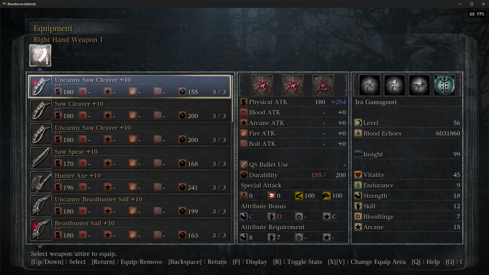
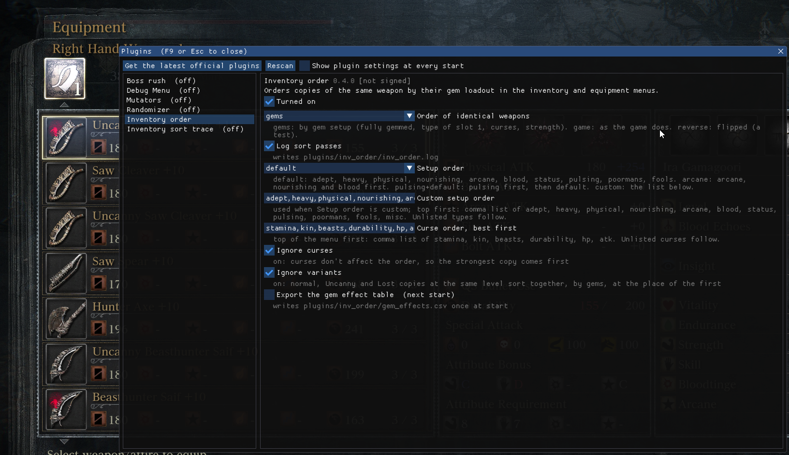

# Inventory order

A [bbhost](https://github.com/droogie/bbhost) plugin for Bloodborne on PC. It puts copies of the same weapon in a **stable, predictable order** in the inventory and equipment menus, based on their blood gems.

Out of the box, the game orders identical weapons by an internal id that can change when items move in and out of storage, so finding the right copy means inspecting gems every time. With this plugin, the copy's gem setup decides its place.



## Install

1. Download `inv_order.dll` from the [Releases](https://gitlab.com/ambientmf/bbhost-inventory-mod/-/releases) page.
2. Put it in the `plugins` folder next to the bbhost executable (`<bbhost folder>\plugins\`).
3. Start bbhost. The plugin is on by default.

Open the inventory or equipment menu: copies of the same weapon are now ordered by their gems. To turn the plugin off, use the launcher's Plugins tab, the in-game plugin menu (F9), or `inv_order = false` under `[plugins]` in `bbhost.toml`.

Requirements:

- Bloodborne 1.09 and bbhost with plugin API 9 or newer (tested with bbhost v0.2.19).
- The DLL is unsigned. bbhost shows it as "not signed" and loads it unless `signed_only = true` is set under `[plugins]`.
- Windows Smart App Control can block an unsigned DLL it hasn't seen before (bbhost logs `error 4551`).

It only changes the order of menu lists, never gameplay or your save.

## How copies are ordered

Weapons stay grouped the way the game groups them (weapon, variant, upgrade level). Within a group of identical weapons, copies are ordered by:

1. **Fully gemmed first**, relative to the weapon's own slot count, then by number of gems.
2. **Setup type**, taken from the gem in **slot 1** (the first filled slot): adept (thrust / blunt %), heavy (STR / SKL scaling), physical (tempering), nourishing, arcane, blood, status (poisons), pulsing, Poorman's, Fool's, then anything else. Put the gem you want a weapon known by in slot 1.
3. **Curses**: milder curses first (see `curse_order` below).
4. **Flat-damage secondaries**, then **strength**: stronger copies first.

Copies with identical gems keep a fixed order.

## Settings

All settings are in the in-game plugin menu (F9 → Inventory order) and take effect at once. They're stored under `[inv_order]` in `bbhost.toml`.



| Setting | Default | What it does |
|---|---|---|
| Order of identical weapons (`ties`) | `gems` | `gems`: order by gem setup. `game`: the game's own order. `reverse`: flipped, a test to see the plugin working. |
| Setup order (`preset`) | `default` | `default`: adept, heavy, physical, nourishing, arcane, blood, status, pulsing, Poorman's, Fool's. `arcane`: arcane, nourishing and blood first. `pulsing+default`: pulsing first. `custom`: the list below. |
| Custom setup order (`type_order`) | the default order | Used when Setup order is `custom`. A comma list, top of the menu first, of `adept, heavy, physical, nourishing, arcane, blood, status, pulsing, poormans, fools, misc`. Types you leave out follow in default order. |
| Curse order (`curse_order`) | `stamina,kin,beasts,durability,hp,atk` | Curses best first. A copy whose worst curse ranks lower sits lower. Curses you leave out follow in default order. |
| Ignore curses (`ignore_curses`) | off | Curses don't count, so the strongest copy comes first. |
| Ignore variants (`ignore_variants`) | off | Normal, Uncanny and Lost copies at the same level sort together, by gems. |
| Log sort passes (`dump`) | off | Writes each sort to `<bbhost data>/plugins/inv_order/inv_order.log`. Useful for bug reports. |

Lists accept any case and extra spaces. Unknown names are skipped and logged.

## License

GPL-3.0-or-later (see `LICENSE`), as bbhost requires of plugins built against its API. `plugin/gem_values.h` is generated from [Noxde/Bloodborne-save-editor](https://github.com/Noxde/Bloodborne-save-editor)'s `upgrades.json` (GPL-3.0). If you pass the DLL on, pass on the source too (this repository, or a copy of it).

## Development

### Building

```sh
tools/build-plugin.sh [path/to/bbhost]    # clang + mingw-w64, from WSL/Linux; uses the bbhost checkout's include/
cp build/inv_order.dll <bbhost folder>/plugins/
```

### How it works

The menu's sort pass builds a record per list entry (`key1` = the sort column's value, `key2` = the item's GaItem handle) and stable-sorts by `key1`, then `key2`. Identical weapons tie on `key1`, so the handle decided their order. The plugin hooks the sort and rewrites `key2` with a rank computed from each copy's gems; `ignore_variants` also rewrites `key1` so variants tie. Addresses are for the 1.09 eboot.

- [`docs/findings.md`](docs/findings.md): the reverse engineering, from save diffs to the comparator.
- [`docs/sort-design.md`](docs/sort-design.md): the ordering rules and the decisions behind them.

### Repo layout

```
plugin/       the plugin (inv_order.c) and the generated gem value table
tools/        build script and save-analysis scripts
docs/         research notes and sort design
screenshots/  in-game test captures
```

Tools (Python 3; set `BB_UPGRADES_JSON` / `BB_WEAPONS_JSON` to the save editor's `resources/*.json` for names and values):

- `inv_dump.py SAVE`: weapons, handles, durability and gems in a save.
- `gem_census.py SAVE...`: every gem in a save, classified by effect kind.
- `predict_order.py SAVE`: the order the plugin will give each group of copies; takes `--ignore-curses`, `--ignore-variants`, `--type-order=` and `--curse-order=`.
- `gen_gem_values.py UPGRADES_JSON`: regenerates `plugin/gem_values.h`.

Game files, saves and RE databases are gitignored; bring your own legally dumped copy of the game.
